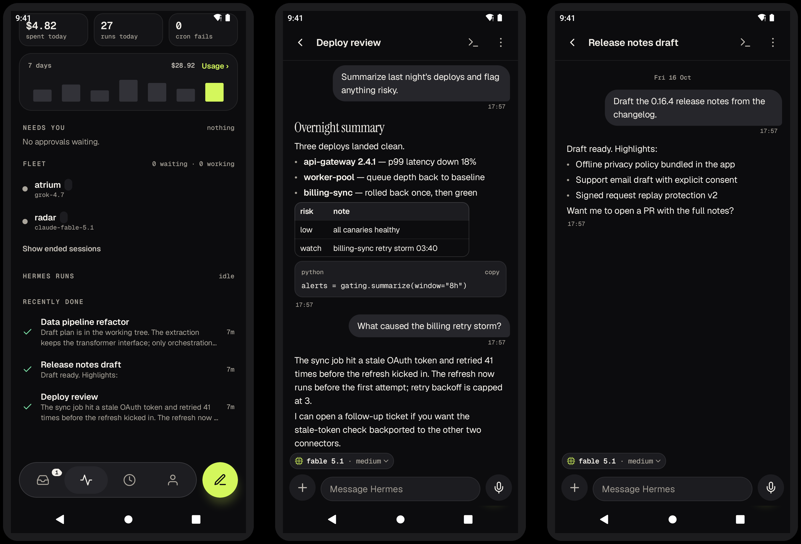
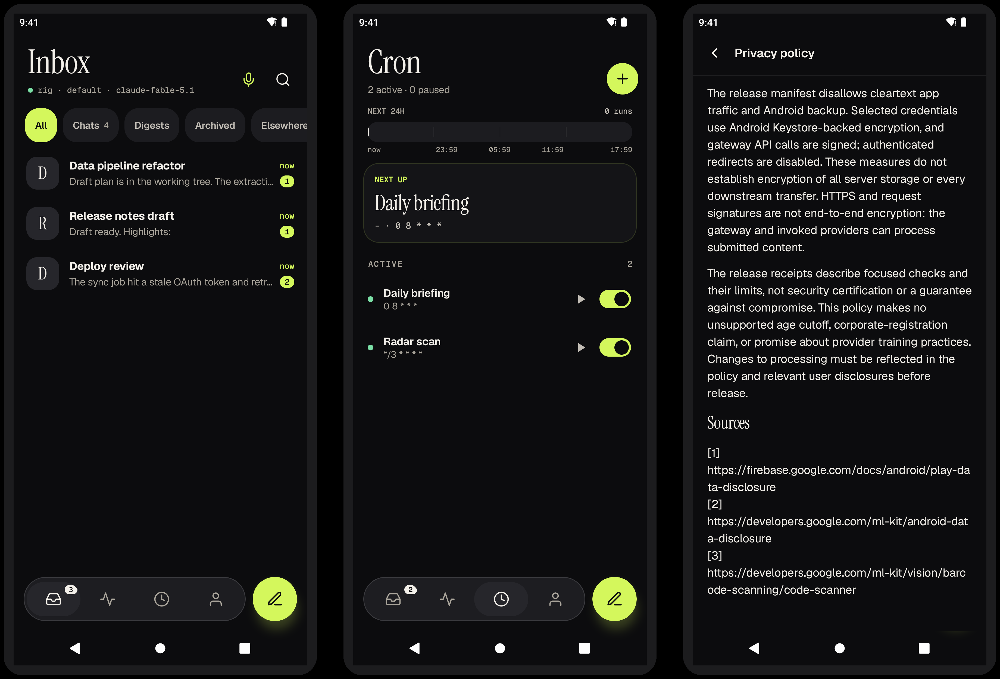

<p align="center">
  
</p>

# Hermes for Android

Your [Hermes Agent](https://github.com/NousResearch/hermes-agent), in your pocket: a native Android
client for the gateway **you** run. Chat, approvals, cron, fleet and optional phone control, with
every request signed by a key that never leaves the phone.

No publisher backend. No accounts. No telemetry. The app pairs to your own server and speaks to it
over an authenticated API; your phone, gateway and configured providers keep the data.

<p align="center">
  
</p>

## What you get

- **Chat that keeps up with the agent.** Stream replies, steer mid-run, queue messages, stop a run.
  Markdown, tables, code cards and diffs render inline; usage, cost and model show per reply.
- **Approvals with real security.** Dangerous commands need biometric or device-credential
  confirmation, bound to the exact request, with durable replay protection on the server.
- **Pulse: the day at a glance.** Spend, runs, failures, a 7-day usage chart, what needs you right
  now, fleet agents and recently finished work.
- **Kitty terminal controls.** Visible Send, named keys and one-shot modifiers, numbered choices,
  native mouse-aware clicks and remote scrolling, with a separate approval for each input.
- **Cron, Wake alarms, Talk.** Manage schedules, set alarms with proofs, dictate with on-device or
  server speech, and wake the app hands-free with on-device "Hey Jarvis" detection.
- **Projects, Radar, Hub.** Browse repos with diffs and PRs, scan releases and papers, install
  skills and plugins, all through Hermes' own write paths.
- **Optional phone control (full build).** Let the agent read and operate other apps via an
  explicitly granted Accessibility service, with a persistent Stop notification and device
  authentication. Off by default.

[Privacy](docs/privacy-policy.md) · [Security](SECURITY.md) · [What was verified](docs/release-0.16.8.md) · [QA scope](docs/android-qa.md) · [Distributions](docs/distribution-flavors.md)

## Install the full APK

Requires **Android 12 or later (API 31+)** and access to your own configured Hermes gateway. The
full package is **`dev.avifenesh.hermes`**. Only use a signed full APK and checksum published
together on this repository's Releases page. A source version bump does not mean an APK has been
published.

Before installation, verify the downloaded APK using `sha256sum` and Android SDK Build Tools'
`apksigner` (add your installed Build Tools directory to `PATH`):

```sh
# Set APK to the file you downloaded. Compare this digest with its release checksum.
APK=Hermes-0.16.8.apk
printf '%s  %s\n' \
  0eba259b916979fa7da1ba80077f19611ca7693916d30de95e17166545bd0f71 "$APK" | sha256sum --check -
apksigner verify --verbose --print-certs "$APK"
```

The approved **signing certificate SHA-256** is:

```text
cdd83d31e6ea91a853a973ed8647cb3a6f5408d1301b2e1e6d06a04bd33a27ee
```

The certificate fingerprint is NOT the APK checksum. Require a successful signature verification,
this exact signer fingerprint, and the matching release's file checksum. If any differ, do not
install. Do not trust a fingerprint taken only from the APK itself. See
[artifact and update security](SECURITY.md).

Open the verified APK on your phone and allow installation from that source when Android asks.
Disable that source's installation permission afterward if you do not need it. For updates, install
over the existing full app without uninstalling: the package and signer must match, and the version
code must be newer. A locally self-signed/debug APK cannot update the publisher-signed app.
Uninstalling removes local data and pairing keys; do not use it to work around a signature
mismatch.

## Install the gateway plugin

First install and configure Hermes using its
[installation guide](https://hermes-agent.nousresearch.com/docs/getting-started/installation).
This plugin uses Hermes' [platform/plugin APIs](https://hermes-agent.nousresearch.com/docs/user-guide/features/plugins);
it is not a standalone server.

**Tested baseline, not a minimum-version promise:** the 15 focused phone transport checks passed
against the local Hermes source revision `9706739432c599bb04eb970eac9229c4b7a1f2e1`, using its
managed Python 3.14.7 runtime. Tracked Hermes sources were unchanged; an unrelated untracked test
file was present. This is not certification of a tagged Hermes release, every API surface or a
fresh-install deployment. No minimum tagged Hermes version has been established. See
[QA](docs/android-qa.md) for scope and reproducible checks.

**Security requirement:** use the complete bundled `server/mobile/` from the same release, not an
old plugin copied from another install. The server must advertise **`security.signature_replay: 2`**.
An updated app alone cannot fix an old server. Read
[request and approval replay protection](docs/request-replay-security.md), including
backup/rollback limitations.

The examples below are run from this repository's root. `HERMES_HOME` selects the intended
profile/data root; it defaults to `~/.hermes`. Stop that profile's gateway before replacing files.
These are operator installation instructions, not actions performed by the test harness.

### Fresh install

```sh
set -eu
umask 077
home="${HERMES_HOME:-$HOME/.hermes}"
export HERMES_HOME="$home"
test -f server/mobile/plugin.yaml
test ! -e "$home/plugins/mobile"
test ! -L "$home/plugins/mobile"
mkdir -p "$home/plugins/mobile"
cp -R server/mobile/. "$home/plugins/mobile/"
test -f "$home/plugins/mobile/plugin.yaml"
hermes plugins enable mobile
```

The `/.` copies the **contents** into the destination. The installed manifest must be
`plugins/mobile/plugin.yaml`, never `plugins/mobile/mobile/plugin.yaml`. If the destination already
exists, use the update procedure rather than repeating a directory-to-directory copy.

### Update an existing plugin

Close API ingress and stop the gateway using the control for the target profile/service before this
block. Keep it stopped until copying finishes. Back up its plugin and mobile data together while
SQLite is not being written:

```sh
set -eu
umask 077
home="${HERMES_HOME:-$HOME/.hermes}"
export HERMES_HOME="$home"
test -f server/mobile/plugin.yaml
test -d "$home/plugins/mobile"
test ! -L "$home/plugins/mobile"
mkdir -p "$HOME/.cache/hermes-mobile-backups"
backup=$(mktemp -d "$HOME/.cache/hermes-mobile-backups/update.XXXXXX")
if test -d "$home/mobile"; then
  mkdir "$backup/mobile"
  cp -R "$home/mobile/." "$backup/mobile/"
fi
mv "$home/plugins/mobile" "$backup/plugin"
mkdir "$home/plugins/mobile"
cp -R server/mobile/. "$home/plugins/mobile/"
test -f "$home/plugins/mobile/plugin.yaml"
printf 'Private backup: %s\n' "$backup"
```

This replaces the whole plugin, so removed files and an old accidentally nested `mobile/` do not
survive. It leaves the active `mobile/` data directory in place. The backup may contain
conversations, pairing credentials and optional Firebase credentials: keep it private and do not
attach it to an issue. Keep the previous code backup for recovery, but do not restore a vulnerable
plugin or stale replay database to an exposed server. If copying fails, leave the gateway stopped
and restore a known-secure complete plugin before reopening ingress.

### Dependencies and configuration

The plugin uses the Hermes runtime's dependencies, not a separate plugin venv. It imports `aiohttp`,
`cryptography` and `httpx`. Optional FCM sending also needs `google-auth` (`google.oauth2` and its
requests transport). Resolve missing dependencies in the managed Hermes runtime using the supported
Hermes package-management workflow; installing into an unrelated system Python will not help. The
plugin's `check_requirements` probes only `aiohttp`, not all of these imports.

These are the plugin's environment variables. Set them in the environment of the gateway you
start. For a managed service, persist them in that service's environment configuration; `hermes
gateway restart` does not guarantee that exports from your current shell reach an existing service.
Do not put non-secret settings into Hermes' secrets `.env` file.

```sh
export MOBILE_ENABLED=1
export MOBILE_ALLOWED_USERS=owner
export MOBILE_PUBLIC_URL=https://myhost.tailnet.ts.net:9445
export MOBILE_BIND=127.0.0.1:47930
# Optional: MOBILE_HOME_CHANNEL (default digests), MOBILE_AGENT_NAME,
# MOBILE_USER_NAME, MOBILE_PHONE_CC (country code for wake escalation).
```

Bind to localhost and expose only through authenticated HTTPS, for example:

```sh
tailscale serve --bg --https=9445 http://127.0.0.1:47930
```

The phone must be able to reach that HTTPS URL and trust its certificate. With Tailscale, both
devices need access to the tailnet; an HTTPS tunnel is another option. Do not expose the plaintext
localhost listener directly to the Internet.

For an initial foreground run from the configured shell, use `hermes gateway run`. For an installed
service, use its supported start/restart control after saving its environment. Once your intended
server is running, check `https://YOUR_SERVER/v1/health`: require `api: 1` and
`security.signature_replay: 2`. The marker is a server assertion, not proof of an unknown host's
trustworthiness.

Then use the same profile/home for pairing:

```sh
hermes mobile pair                 # one-use QR/link, valid 10 minutes
hermes mobile devices
hermes mobile revoke DEVICE_ID    # replace DEVICE_ID with the listed lost/unwanted phone
```

Scan the QR or paste the pairing link on the first screen. Pairing links are secrets; never publish
one. `hermes mobile check` is an operator self-check against real configured state, **not** an
isolated public test. Do not run it against a production home for a test-suite receipt.

### Optional Firebase push

Without push, text chat and live connection sync still work. Android may limit background dataSync
services; periodic WorkManager sync is a fallback, not an instant-delivery guarantee.

Create a Firebase Android client for `dev.avifenesh.hermes` in your own project. Put its server
service-account JSON in `$HERMES_HOME/mobile/fcm-service-account.json` (default
`~/.hermes/mobile/fcm-service-account.json`). Keep that credential server-only and restrict its
filesystem access. Do not ship it in an APK, repository, client config or bug report.

Put **only client configuration** in `$HERMES_HOME/mobile/fcm-client.json`:

```json
{
  "api_key": "YOUR_FIREBASE_ANDROID_API_KEY",
  "app_id": "1:YOUR_PROJECT_NUMBER:android:YOUR_APP_ID",
  "project_id": "YOUR_FIREBASE_PROJECT_ID",
  "sender_id": "YOUR_PROJECT_NUMBER"
}
```

All four values are strings. `app_id` is the Firebase application ID, not the Android package
name. The field names come from `FirebaseOptions.Builder` in `App.kt`. The paired app retrieves
this through signed `/v1/push-config`; no bundled `google-services.json` is needed. The server
returns it only when service-account configuration is also present. Use a matching project/client
and appropriate Firebase API restrictions. Never add private keys to this client JSON: it is sent
to paired phones.

Google Play services, successful token acquisition and server token registration are required
before push is ready. Config files alone do not prove delivery. Changing Firebase projects requires
restarting the Android app process. A separately installed Play-flavor package needs its own
appropriate Firebase registration. Google services can process installation identifiers, tokens
and SDK/service diagnostics even though wake hints contain no message text.

## Phone control (full distribution only)

From **Me → This phone → Control**, enable **Hermes phone control** in Android Accessibility
settings, then turn on **Allow agent control**. Arming uses the fingerprint/PIN signature used for
other power-widening actions. On a sideloaded install, Android may first require
**Settings → Apps → Hermes → ⋮ → Allow restricted settings**. Grant this only after verifying the
APK and understanding the access.

Enable the toolset on the mobile platform if needed:

```sh
hermes tools enable --platform mobile phone_use
```

The agent gets one `phone_use` tool. Start with `action=state` to read indexed elements and a
screenshot. It supports taps, long presses, text entry, scrolling, swipes, system keys, app launch,
app lists and window lists. Coordinates use physical screen pixels. Read state again after changing
the screen.

State defaults to the focused screen with keyboard/background-window noise excluded. Use
`scope="all"` and `include_keyboard=true` when needed. Elements expose `checkable`, `checked`,
`selected` and `focused`. Taps accept `method="auto"`, `"gesture"` or `"accessibility"`. Auto uses
one short physical tap for checkable controls; elsewhere it falls back only on explicit
Accessibility rejection. An accepted dispatch is not proof of its effect.

- Control is opt-in per phone. Only the armed phone can fetch or answer its commands.
- SSE/FCM carry wake hints. Commands expire, serialize and are canceled by disarming or revocation.
- **Stop control** on screen or in the notification is a local kill switch even if the server is
  unreachable. A visible notification is required for arming.
- The screen must be on and unlocked. Password-field text is redacted and password typing is
  refused. Android can block screenshots on protected screens; these safeguards are not an
  exhaustive privacy boundary for every app.
- Switching machines or unpairing turns phone control off.

## Platform and privacy limits

Camera, microphone and step sensors are optional; denying their permissions does not block text
chat. Pair by pasting the link when Google code scanning is unavailable. Google code scanning and
Firebase push require Google Play services; a Google-free device does not gain those features from
this APK.

Wake-word detection runs locally, but **speech recognition is not guaranteed offline**: Talk
prefers an available on-device recognizer and can fall back to the system recognizer, which may use
a cloud service. Server-configured TTS can use providers, with device TTS as a fallback. Models,
recognition/TTS providers, Firebase and Google SDKs have their own terms and data practices.
Bundled open-source notices do not license third-party service access. See
[privacy](docs/privacy-policy.md), [licenses](licenses/README.md) and
[model provenance](licenses/MODEL-PROVENANCE.txt).

Support and private security reports: **[hello@tiyuvta.ai](mailto:hello@tiyuvta.ai)**. Include
version/package and sanitized reproduction steps, not tokens, pairing links, keys, full databases
or private chats. Sending support mail is voluntary and uses your mail app/provider. See
[SECURITY.md](SECURITY.md).

## Focused verification

From this repository's root, set `HERMES_PYTHON` to the Python executable in your **installed
Hermes managed runtime**. On an older venv-based installation it may be
`~/.hermes/hermes-agent/venv/bin/python`; confirm it is the active runtime, not a stale interpreter
from before a Hermes upgrade. The phone harness disables automatic lazy dependency
installs/relaunches. It needs the existing managed dependencies and the Hermes source checkout at
`~/.hermes/hermes-agent`.

```sh
"$HERMES_PYTHON" scripts/phone_control_integration.py
"$HERMES_PYTHON" scripts/replay_security_integration.py
```

Run these scripts directly in fresh processes; do not import bootstrap or discover plugins first.
The phone harness force-sets a disposable `HERMES_HOME` before application imports, disables
project-plugin discovery and refuses a pre-bootstrapped process. It uses temporary loopback
servers, real SQLite/P-256/auth/biometric guards and synthetic devices. Its 15 checks substitute
FCM credentials/network and do not demonstrate Android execution, real push, production deployment
or full compatibility. See [QA](docs/android-qa.md).

## Development

[`avifenesh/hermes-android-app`](https://github.com/avifenesh/hermes-android-app) is the single
development and release repository for both the Android client and its gateway plugin. Open issues
and pull requests here against `main`. There is no separate development repo or export/sync step.
Use the build instructions below and the [distribution checks](docs/distribution-flavors.md).

## Build the full app

Needs JDK 21, Android compile SDK 37 / target SDK 36, NDK 29.0.14206865 and CMake 3.22.1. Initial
native configuration downloads pinned archives; runtime wake detection is offline. Release APKs
include ARM64, ARMv7, x86 and x86-64 native libraries.

For a local unsigned-by-the-publisher debug build:

```sh
cd android
# Set JAVA_HOME to your JDK 21 installation and configure your Android SDK.
./gradlew :app:assembleFullDebug
./gradlew --stop
```

For your own release build, copy [android/keystore.properties.example](android/keystore.properties.example)
to `android/keystore.properties` and fill it with your own signing inputs. Keep the file and
keystore private; never commit them. An alternate properties path is supported via
`-PhermesSigningProperties=/path/to/signing.properties`. Do not put passwords on the command line.
Release tasks fail without complete signing inputs and never silently use a debug key.

```sh
cd android
./gradlew :app:assembleFullRelease
./gradlew --stop
# app/build/outputs/apk/full/release/app-full-release.apk
```

Use explicit flavored tasks. `assembleRelease`/`assembleDebug` aggregate both flavors; they are not
full-only. A self-built APK has your signer, not the approved publisher signer. See
[distribution/build checks](docs/distribution-flavors.md) for maintainer validation; Play tasks
are optional development work, not prerequisites for GitHub installation.

## Layout

| Path | What |
|---|---|
| `android/` | Compose client and full/Play source sets |
| `server/mobile/adapter.py` | Platform adapter, signed HTTP/SSE API and CLI |
| `server/mobile/sig.py`, `store.py` | Request/approval signatures and persistent replay claims |
| `server/mobile/control.py`, `control2.py` | Hermes control surfaces |
| `server/mobile/selfcheck.py` | Operator self-check |
| `scripts/phone_control_integration.py` | Isolated phone transport checks |
| `scripts/replay_security_integration.py` | Isolated replay security checks |

## License

MIT. Bundled model and native-library notices are in [licenses/](licenses/).
